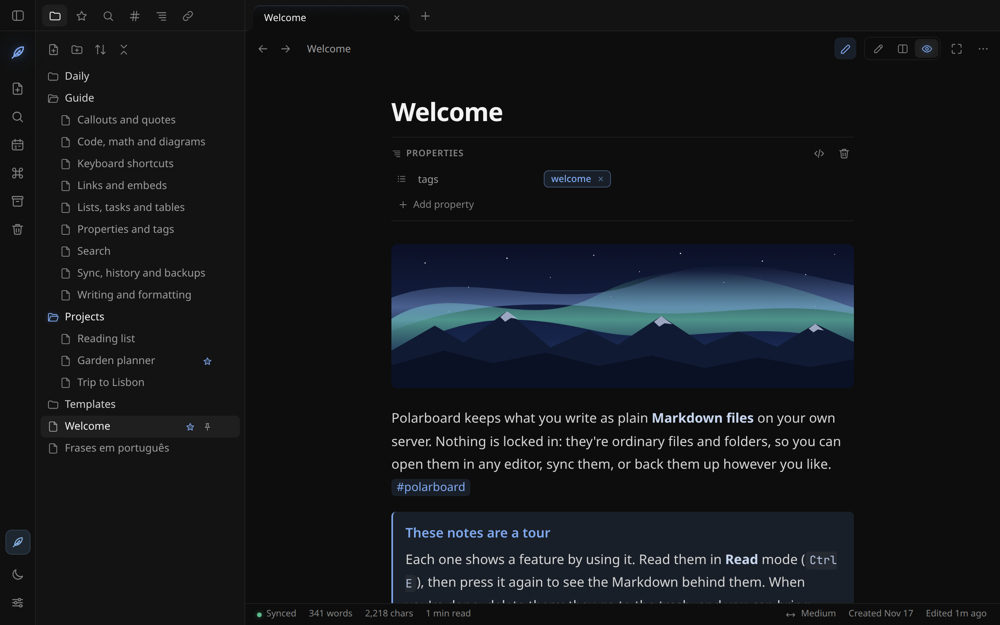

<p align="center"></p>

<h1 align="center">Polarboard</h1>

<p align="center"></p>

Polarboard is a notes app you run yourself. Your notes are ordinary `.md` files in folders, so you can open them in Obsidian, VS Code or any editor, and back them up or sync them however you like. The server is a single Python file with no dependencies; the app runs in any browser, keeps working offline, and installs on your phone.

## Highlights

- **Write in Markdown**, colored as you type, with a Read mode, a side-by-side Split mode and editing in place.
- **Links between notes** with `[[wikilinks]]`, backlinks, hover previews, and notes or sections embedded in other notes.
- **Code, math and diagrams**: highlighted code, KaTeX math and Mermaid diagrams, loaded only when a note uses them.
- **Fast full-text search** with `tag:`, `path:`, `title:`, `"exact phrases"` and `-exclusions`.
- **Works offline**: keep reading, editing and creating notes without a connection; changes sync when you're back, and conflicts are yours to settle.
- **Never lose a word**: version history, a trash, an archive, scheduled backups and optional git.
- **Writing checks** by [Harper](https://github.com/Automattic/harper): spelling, grammar and style, entirely in your browser.
- **Several accounts**, each its own set of notes with an optional password, plus API tokens for scripts.

## Quick start

**With Podman or Docker** (recommended):

```sh
git clone <this repository> polarboard && cd polarboard
podman compose up -d --build        # or: docker compose up -d --build
```

**Or directly with Python** 3.10 or newer (nothing to install; `git` is optional):

```sh
python3 server.py
```

Then open **http://localhost:8787**. A fresh install starts with a short tour: a set of example notes that each show a feature by using it. Read them, then delete what you don't need.

## Self-hosting

### Put it behind HTTPS

On your home network, `http://server:8787` is fine. Anywhere else, put Polarboard behind a reverse proxy with HTTPS (or reach it over a VPN such as Tailscale). HTTPS also lets the app itself install and open offline.

With [Caddy](https://caddyserver.com), that's the whole configuration:

```caddy
notes.example.com {
    reverse_proxy localhost:8787
}
```

With nginx, pass the scheme along and allow large uploads (imports can be up to 300 MB):

```nginx
location / {
    proxy_pass http://127.0.0.1:8787;
    proxy_set_header Host $host;
    proxy_set_header X-Forwarded-Proto $scheme;
    proxy_set_header X-Forwarded-For $proxy_add_x_forwarded_for;
    client_max_body_size 300m;
}
```

Live updates use server-sent events; Polarboard already tells nginx not to buffer them.

### Accounts and passwords

Polarboard starts with one account, **polarboard**, with no password, so it opens straight away. Before others can reach it:

- **Give the account a password** in **Settings → General**. Passwords are per account and optional; a device asks for it once and can stay unlocked.
- **Set `POLARBOARD_PASSWORD`**, a server password needed to add or delete accounts. Without it, anyone who can reach the server can add an account.
- **Wrong passwords are limited** to 8 per account every 10 minutes (`POLARBOARD_LOGIN_TRIES`, `POLARBOARD_LOGIN_WINDOW`).

An account without a password opens for anyone who can reach the server. Notes are stored as plain files and are not encrypted at rest; encrypt the disk if that matters to you.

### Run it as a service (without containers)

```ini
# /etc/systemd/system/polarboard.service
[Unit]
Description=Polarboard notes
After=network.target

[Service]
ExecStart=/usr/bin/python3 /opt/polarboard/server.py
Environment=POLARBOARD_DATA=/var/lib/polarboard
DynamicUser=yes
StateDirectory=polarboard
Restart=on-failure

[Install]
WantedBy=multi-user.target
```

```sh
sudo systemctl enable --now polarboard
```

### Back it up

Everything lives in one folder (`./data` with Compose, `POLARBOARD_DATA` otherwise), as plain files, so any backup tool works. Polarboard can also:

- download a `.zip` of an account at any time (**Settings → Sync**),
- write scheduled backups (hourly, daily or weekly) to `POLARBOARD_BACKUPS`. Mount a NAS folder there (see `compose.yaml`) so a backup survives the server's own disk,
- commit each account to git on a schedule and push it to a remote.

### Update

```sh
git pull
podman compose up -d --build        # or restart python3 server.py
```

Your notes are untouched; reload the page in the browser to get the new version.

### Configuration

Everything is set with environment variables (in `compose.yaml` for containers):

| Variable | Default | What it does |
| :--- | :--- | :--- |
| `POLARBOARD_DATA` | the app folder | Where accounts, their notes and share links are kept |
| `POLARBOARD_VAULT` | `$POLARBOARD_DATA/vault` | Notes of the first account |
| `POLARBOARD_PORT` | `8787` | Port to listen on |
| `POLARBOARD_HOST` | `0.0.0.0` | Address to listen on (`127.0.0.1` for the proxy only) |
| `POLARBOARD_PASSWORD` | *(none)* | Server password, needed to add or delete accounts |
| `POLARBOARD_LOGIN_TRIES` | `8` | Wrong passwords allowed per account before it has to wait. `0` turns the limit off |
| `POLARBOARD_LOGIN_WINDOW` | `10` | Minutes those wrong passwords are counted over |
| `POLARBOARD_BACKUPS` | `$POLARBOARD_DATA/backups` | Where scheduled backups go, one folder per account |
| `POLARBOARD_EXAMPLES` | `examples/` | Starter notes for a new, empty first account. Point it at your own folder, or an empty one for none |
| `POLARBOARD_LOG` | *(off)* | `1` logs every request |

`/healthz` answers `ok` without logging in, for uptime monitors and container health checks.

### What's on disk

```
data/
  vault/                    the first account's notes, as plain .md files
    attachments/            images pasted or dropped into notes
    .trash/                 deleted notes, restorable for 30 days (by default)
    .archive/               archived notes, read-only, in the folders they came from
    .polarboard/            dates, tags, stars, settings, history, dictionary, API tokens
  vaults/<id>/              accounts added in the app, same layout
  backups/<id>/             scheduled backups
  .polarboard-server/       account list, password hashes, sessions, share links
```

## Features

<details>
<summary><b>Writing</b></summary>

- **Markdown, colored as you type**, with headings, bold, italics, strikethrough, ==highlights==, code, links and quotes each in its own color: shades of your accent by default, or your own picks (**Settings → Appearance → Text colors**).
- **Read, Write and Split modes** (`Ctrl E`), and **editing in place**: in Read mode, click a paragraph, list or table to edit its Markdown right there.
- **Slash menu:** type `/` at the start of a line for headings, checklists, tables, callouts, code, math, diagrams, embeds, templates and properties.
- **Tables that line themselves up:** `Tab` moves between cells, `Enter` adds a row, `Ctrl Shift L` tidies the table.
- **Callouts** (`> [!tip]`, `[!warning]`, …), **checklists**, smart lists, auto-paired brackets, typewriter scrolling and **focus mode** (`Ctrl Shift F`).
- **Code, math and diagrams:** highlight.js, KaTeX (`$…$`, `$$…$$`) and Mermaid, each loaded only when a note needs it.
- **Properties:** front matter shown as a small panel above the note, in the same format Obsidian uses.
- **Find and replace** (`Ctrl F`, `Ctrl H`) with match case, whole words and regular expressions.
- **Daily notes** (`Alt D`) and **templates** (`Alt Shift T`) with `{{date}}`, `{{date:dddd D MMMM}}`, `{{time}}`, `{{title}}`, `{{yesterday}}`, `{{tomorrow}}` and `{{cursor}}`.

</details>

<details>
<summary><b>Writing checks</b></summary>

[Harper](https://github.com/Automattic/harper) checks spelling, grammar, punctuation and style as you write. It runs as WebAssembly in your browser, so nothing you write leaves your server.

- Right-click an underline for fixes, **Add to dictionary**, **Ignore here** (remembered on every device; only a hash of the spot is stored, never the text), or **Turn off** that rule. `F8` steps through them.
- Choose your English dialect, which groups to check, and single rules in **Settings → Editor**. The personal dictionary is shared by every device using the account.
- Give a note the property `spellcheck: false` to skip it, for example one written in another language, or turn on **Skip text that isn't English**.

</details>

<details>
<summary><b>Linking and organizing</b></summary>

- **`[[Wikilinks]]`** with suggestions as you type, `[[Note|another label]]`, `[[Note#Heading]]`, and ordinary Markdown links. Renaming or moving a note updates the links to it.
- **Backlinks** and unlinked mentions, **hover previews** of links, and **Open to the side** (`Ctrl Alt O`) to read one note while writing another.
- **Embeds:** `![[Other note]]` shows a note inside another, `![[Other note#Heading]]` just one section, and `![[image.png|320]]` an image at a set width.
- **Folders** with their own sort order and their own page (any note can be attached to a folder).
- **Tags** written as `#tag` or `#nested/tag`, in properties, or given to every note in a folder at once.
- **Stars** (`Alt S`), pins, tabs, an outline of the open note, and a command palette (`Ctrl Shift P`) for everything.

</details>

<details>
<summary><b>Search</b></summary>

Full-text search (SQLite FTS5, built into Python) where partial words match: `gard` finds "garden" and "gardening".

| Write | Finds |
| :--- | :--- |
| `tomato basil` | Notes with both words |
| `"cherry tomatoes"` | That exact phrase |
| `tag:project` | Notes tagged #project (and #project/anything) |
| `path:Daily` | Notes whose folder or name contains "Daily" |
| `title:plan` | Notes whose name contains "plan" |
| `-word`, `-tag:draft` | Leaves those out |

</details>

<details>
<summary><b>Sync, offline and conflicts</b></summary>

| Mode | What happens |
| :--- | :--- |
| **Live** (default) | Saves as you type; changes from other devices appear immediately |
| **Interval** | Saves as you type; checks other devices on a timer |
| **Manual** | Edits stay on this device until you press Sync (`Ctrl S`) |

Every note you open is also kept in the browser (optionally all of them), so you can keep reading, editing and creating notes when the connection drops. Edits are sent when the server is back. If a note changed elsewhere in the meantime, the status bar shows **Conflict**: keep your version, theirs, or both.

</details>

<details>
<summary><b>History, trash, archive and backups</b></summary>

- **Version history** (`Alt H`): earlier versions are kept as you edit. **Changes** shows what's different, with the edited words marked, and any version can be restored.
- **Trash:** the bin in the left rail lists deleted notes; read one, restore it, or delete it for good. It empties itself after 30 days by default.
- **Archive:** right-click → **Archive** puts a note or folder away without deleting it. It leaves the note list, search and links, keeps its tags and history, and opens read-only from the box in the left rail until you unarchive it.
- **Backups:** a `.zip` download at any time, scheduled backups on the server, and optional git commits pushed to a remote.

</details>

<details>
<summary><b>Sharing, export and import</b></summary>

- **Share links:** right-click a note → **Share link** for a read-only page, optionally expiring. Visitors see only that note and its images.
- **Export** a note as a PDF (with header, footer, page numbers, paper size and margins), a self-contained HTML file, or Markdown.
- **Import** `.md` and `.txt` files, images, or a `.zip` of a folder or an Obsidian vault. Nothing already there is overwritten.
- **Unused attachments:** find images no note uses any more and move the ones you pick to the trash.

</details>

<details>
<summary><b>Look and feel, phones and keyboard</b></summary>

- Light, dark or automatic; an accent color of your choice; a little film grain if you like it.
- **On a phone:** swipe in from the left edge for the sidebar, and press and hold a note for its menu. The app installs to the home screen and opens offline (over HTTPS).
- **Keyboard first:** every command has a shortcut you can change in **Settings → Hotkeys**, and the sidebar works with the arrow keys, `Enter`, `F2`, `Delete` and `Shift F10`.

| Keys | Does |
| :--- | :--- |
| `Ctrl O` | Open a note by name |
| `Ctrl P` | Search inside notes |
| `Ctrl Shift P` | Command palette |
| `Ctrl E` | Switch between writing and reading |
| `Ctrl \` | Show or hide the sidebar |
| `Alt N` / `Alt D` | New note / today's note |
| `Alt T` / `Alt W` | New tab / close tab |
| `Alt S` / `Alt H` | Star the note / version history |
| `Ctrl F` / `Ctrl H` | Find / find and replace |
| `Ctrl B` / `Ctrl I` / `Ctrl K` | Bold / italic / link |
| `Ctrl S` | Save and sync now |
| `Ctrl Shift F` | Focus mode |
| `F8` | Next writing suggestion |

Firefox keeps `Ctrl Shift P` for itself; give the palette another key in **Settings → Hotkeys**.

</details>

<p align="center"></p>

## API and automation

Create a token in **Settings → Keychain**. Tokens belong to one account and can read and write its notes, but can't change the account, its tokens or its shares. Scripts can also sign in with `curl -u <account>:<password>`.

```sh
# list every note
curl -H "Authorization: Bearer pb_…" https://notes.example.com/api/tree

# append a line to Inbox.md (created if needed)
curl -X POST -H "Authorization: Bearer pb_…" \
  -d '{"path": "Inbox", "text": "- remember this"}' https://notes.example.com/api/append
```

Without a token, write requests need the header `X-Polarboard: 1`.

## Development

There's no build step: edit a file and reload the page. The end-to-end tests start a real server on a throwaway folder and drive the app in Chromium:

```sh
pip install playwright && playwright install chromium    # once
python3 tests/run.py                  # everything, about three minutes
python3 tests/run.py spell bins       # just tests/test_spell.py and tests/test_bins.py
```

```
server.py              the whole server: HTTP, JSON API, search, history, backups
examples/              the notes a fresh install starts with
static/index.html      the app's page             static/share.html   a shared note's page
static/app.js          loads static/app/          static/app/*.js     the app, one module per area
static/markdown.js     Markdown renderer (escapes all raw HTML)
static/editor.js       editor commands            static/props.js     properties panel
static/spell.js        Harper integration         static/rich.js      code, math, diagrams
static/settings.js     settings window            static/export.js    PDF and HTML export
static/app.css         look and feel              static/print.css    printed and exported pages
static/sw.js           offline app shell          static/offline.js   offline note cache
static/vendor/         bundled libraries (see THIRD_PARTY_NOTICES.md)
tests/                 end-to-end tests (see tests/README.md)
```

## Credits

Polarboard bundles [Harper](https://github.com/Automattic/harper), [highlight.js](https://highlightjs.org), [KaTeX](https://katex.org) and [Mermaid](https://mermaid.js.org). Their licenses are in [THIRD_PARTY_NOTICES.md](THIRD_PARTY_NOTICES.md).
