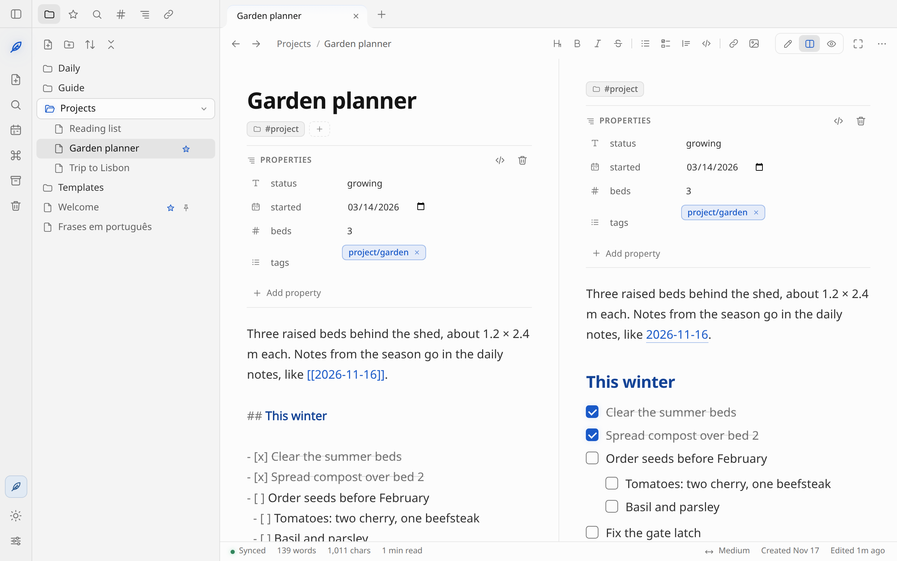

<p align="center"></p>

<h1 align="center">Polarboard</h1>

<p align="center"></p>

Your notes are ordinary `.md` files in folders, ready for Obsidian, VS Code or any editor. The server is one Python file with no dependencies. The app runs in any browser, works offline and installs on your phone.

## Highlights

- **Markdown**, colored as you type, with Read, Write and Split modes
- **`[[Wikilinks]]`**, backlinks, hover previews and embeds
- **Code, math and diagrams** with highlight.js, KaTeX and Mermaid
- **Full-text search** with `tag:`, `path:`, `title:`, `"phrases"` and `-exclusions`
- **Offline first**: edits sync when you're back, and you settle any conflicts
- **Nothing lost**: version history, trash, archive, backups and optional git
- **Writing checks** by [Harper](https://github.com/Automattic/harper), run in your browser
- **Several accounts**, each with its own notes, optional password and API tokens

## Quick start

With Podman or Docker (recommended):

```sh
git clone <this repository> polarboard && cd polarboard
podman compose up -d --build        # or: docker compose up -d --build
```

Or with Python 3.10+, nothing to install:

```sh
python3 server.py
```

Open **http://localhost:8787**. A fresh install comes with example notes that tour every feature. Delete them when you're done.

## Self-hosting

### HTTPS

Plain `http://` is fine at home. Anywhere else, use a reverse proxy with HTTPS, or a VPN such as Tailscale. HTTPS also lets the app install and open offline.

[Caddy](https://caddyserver.com):

```caddy
notes.example.com {
    reverse_proxy localhost:8787
}
```

nginx (imports can be up to 300 MB):

```nginx
location / {
    proxy_pass http://127.0.0.1:8787;
    proxy_set_header Host $host;
    proxy_set_header X-Forwarded-Proto $scheme;
    proxy_set_header X-Forwarded-For $proxy_add_x_forwarded_for;
    client_max_body_size 300m;
}
```

### Accounts and passwords

Polarboard starts with one account, **polarboard**, and no password. Before anyone else can reach it:

- **Set an account password** in **Settings → General**. Each device asks once and can stay signed in.
- **Set `POLARBOARD_PASSWORD`**. Without it, anyone who can reach the server can add accounts.

Wrong passwords are limited to 8 per account every 10 minutes.

> [!NOTE]
> Notes are plain files, not encrypted. A password controls who can open them. Encrypt the disk if you need more.

### Run as a service

Without containers, use systemd:

```ini
# /etc/systemd/system/polarboard.service
[Unit]
Description=Polarboard notes
After=network.target

[Service]
ExecStart=/usr/bin/python3 /opt/polarboard/server.py
Environment=POLARBOARD_DATA=/var/lib/polarboard
DynamicUser=yes
StateDirectory=polarboard
Restart=on-failure

[Install]
WantedBy=multi-user.target
```

```sh
sudo systemctl enable --now polarboard
```

### Backups

Everything lives in one folder of plain files (`./data` with Compose), so any backup tool works. Polarboard can also:

- download an account as a `.zip` (**Settings → Sync**)
- save backups hourly, daily or weekly to `POLARBOARD_BACKUPS`. Point it at a NAS so backups survive a dead disk.
- commit to git on a schedule and push to a remote

### Updating

```sh
git pull
podman compose up -d --build        # or restart python3 server.py
```

Notes are untouched. Reload the page to get the new version.

### Configuration

Set these as environment variables, in `compose.yaml` for containers.

| Variable | Default | Purpose |
| :--- | :--- | :--- |
| `POLARBOARD_DATA` | app folder | Accounts, notes and share links |
| `POLARBOARD_VAULT` | `$POLARBOARD_DATA/vault` | The first account's notes |
| `POLARBOARD_PORT` | `8787` | Port |
| `POLARBOARD_HOST` | `0.0.0.0` | Address (`127.0.0.1` behind a proxy) |
| `POLARBOARD_PASSWORD` | *(none)* | Needed to add or delete accounts |
| `POLARBOARD_LOGIN_TRIES` | `8` | Wrong passwords allowed per account (`0` = no limit) |
| `POLARBOARD_LOGIN_WINDOW` | `10` | Minutes they're counted over |
| `POLARBOARD_BACKUPS` | `$POLARBOARD_DATA/backups` | Scheduled backups |
| `POLARBOARD_EXAMPLES` | `examples/` | Starter notes (an empty folder for none) |
| `POLARBOARD_LOG` | *(off)* | `1` logs every request |

`/healthz` returns `ok` without signing in, for uptime monitors.

### What's on disk

```
data/
  vault/               the first account's notes
    attachments/       pasted and dropped images
    .trash/            deleted notes (kept 30 days)
    .archive/          archived notes, read-only
    .polarboard/       tags, settings, history, dictionary, tokens
  vaults/<id>/         other accounts, same layout
  backups/<id>/        scheduled backups
  .polarboard-server/  accounts, password hashes, sessions, shares
```

## Features

<details>
<summary><b>Writing</b></summary>

- **Colored Markdown**: headings, bold, italics, highlights, code and links each get a shade of your accent. Change them in **Settings → Appearance**.
- **Read, Write and Split** (`Ctrl E`). In Read mode, click any paragraph, list or table to edit it in place.
- **Slash menu**: `/` at the start of a line adds headings, tables, callouts, code, math, embeds and more.
- **Tables**: `Tab` between cells, `Enter` for a new row, `Ctrl Shift L` to tidy.
- **Callouts**, checklists, smart lists, typewriter scrolling and **focus mode** (`Ctrl Shift F`).
- **Properties**: front matter in a small panel, in the format Obsidian uses.
- **Find and replace** (`Ctrl F`, `Ctrl H`) with case, whole-word and regex options.
- **Daily notes** (`Alt D`) and **templates** (`Alt Shift T`) with `{{date}}`, `{{time}}`, `{{title}}`, `{{cursor}}` and more.

</details>

<details>
<summary><b>Writing checks</b></summary>

[Harper](https://github.com/Automattic/harper) checks spelling, grammar and style as you type. It runs in your browser, so your writing never leaves your server.

- Right-click an underline to fix it, add the word to your dictionary, ignore it there, or turn off the rule. `F8` jumps to the next one.
- Pick your dialect and rules in **Settings → Editor**. Your dictionary is shared across devices.
- Add `spellcheck: false` to a note's properties to skip it, for example a note in another language.

</details>

<details>
<summary><b>Linking and organizing</b></summary>

- **`[[Wikilinks]]`** with suggestions, labels (`[[Note|label]]`) and headings (`[[Note#Heading]]`). Renaming or moving a note updates its links.
- **Backlinks**, hover previews, and **Open to the side** (`Ctrl Alt O`).
- **Embeds**: `![[Note]]`, `![[Note#Heading]]`, or `![[image.png|320]]` for an image at a set width.
- **Folders** with their own sort order and folder page.
- **Tags**: `#tag` or `#nested/tag`, in properties, or on a whole folder.
- **Stars**, pins, colors, tabs, an outline and a command palette (`Ctrl Shift P`).

</details>

<details>
<summary><b>Search</b></summary>

Partial words match: `gard` finds "garden" and "gardening".

| Search | Finds |
| :--- | :--- |
| `tomato basil` | Both words |
| `"cherry tomatoes"` | The exact phrase |
| `tag:project` | #project and its nested tags |
| `path:Daily` | Folder or name contains "Daily" |
| `title:plan` | Name contains "plan" |
| `-word`, `-tag:draft` | Leaves these out |

</details>

<details>
<summary><b>Sync and offline</b></summary>

| Mode | Saves | Other devices' changes |
| :--- | :--- | :--- |
| **Live** (default) | As you type | Right away |
| **Interval** | As you type | On a timer |
| **Manual** | When you press `Ctrl S` | When you press `Ctrl S` |

Opened notes stay in the browser (or all of them, if you choose), so you can keep working offline. If a note changed elsewhere meanwhile, you'll see **Conflict**. Keep yours, theirs or both.

</details>

<details>
<summary><b>History, trash and archive</b></summary>

- **Version history** (`Alt H`): see what changed, word by word, and restore any version.
- **Trash**: the bin in the left rail. Read, restore or delete notes for good. Empties after 30 days.
- **Archive**: right-click → **Archive** to put a note or folder away. It leaves your notes, search and links, and stays read-only until you bring it back.

</details>

<details>
<summary><b>Sharing, export and import</b></summary>

- **Share links**: a read-only page for one note, with an optional expiry date.
- **Export** to PDF, a self-contained HTML file, or Markdown.
- **Import** Markdown, text, images, or a `.zip` of a folder or Obsidian vault. Nothing is overwritten.
- **Unused attachments**: find images no note uses and trash them.

</details>

<details>
<summary><b>Look and feel, phones and keyboard</b></summary>

- Light, dark or automatic, with your own accent color.
- **Phones**: swipe from the left edge for the sidebar, and press and hold for menus. Installs to the home screen over HTTPS.
- **Keyboard**: change any shortcut in **Settings → Hotkeys**. The sidebar works with arrow keys too.

| Keys | Does |
| :--- | :--- |
| `Ctrl O` | Open a note |
| `Ctrl P` | Search |
| `Ctrl Shift P` | Command palette |
| `Ctrl E` | Write / read |
| `Ctrl \` | Sidebar |
| `Alt N` / `Alt D` | New note / today's note |
| `Alt T` / `Alt W` | New tab / close tab |
| `Alt S` / `Alt H` | Star / history |
| `Ctrl F` / `Ctrl H` | Find / replace |
| `Ctrl B` / `Ctrl I` / `Ctrl K` | Bold / italic / link |
| `Ctrl S` | Sync now |
| `Ctrl Shift F` | Focus mode |
| `F8` | Next writing suggestion |

Firefox reserves `Ctrl Shift P`, so give the palette another key there.

</details>

<p align="center"></p>

## API

Create a token in **Settings → Keychain**. A token can read and write one account's notes, but can't change its settings. Scripts can also use `curl -u <account>:<password>`.

```sh
# list every note
curl -H "Authorization: Bearer pb_…" https://notes.example.com/api/tree

# add a line to Inbox.md (creates it if needed)
curl -X POST -H "Authorization: Bearer pb_…" \
  -d '{"path": "Inbox", "text": "- remember this"}' https://notes.example.com/api/append
```

Requests that change notes without a token need the header `X-Polarboard: 1`.

## Development

No build step: edit a file and reload. The tests drive a real server in Chromium:

```sh
pip install playwright && playwright install chromium    # once
python3 tests/run.py                  # everything, about 3 minutes
python3 tests/run.py spell bins       # only test_spell.py and test_bins.py
```

```
server.py            the server: HTTP, API, search, history, backups
examples/            starter notes
static/index.html    the app           static/share.html   shared notes
static/app/*.js      app modules       static/markdown.js  Markdown renderer
static/editor.js     editor commands   static/props.js     properties panel
static/spell.js      Harper            static/rich.js      code, math, diagrams
static/settings.js   settings          static/export.js    PDF and HTML export
static/app.css       styles            static/print.css    print styles
static/sw.js         offline shell     static/offline.js   offline notes
static/vendor/       bundled libraries
tests/               end-to-end tests (see tests/README.md)
```

## Credits

Polarboard bundles [Harper](https://github.com/Automattic/harper), [highlight.js](https://highlightjs.org), [KaTeX](https://katex.org) and [Mermaid](https://mermaid.js.org). Their licenses are in [THIRD_PARTY_NOTICES.md](THIRD_PARTY_NOTICES.md).

## License

[AGPL-3.0](LICENSE). Use, change and share it freely. If you run a changed version for others over a network, share its source under the same license.
