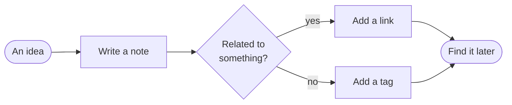
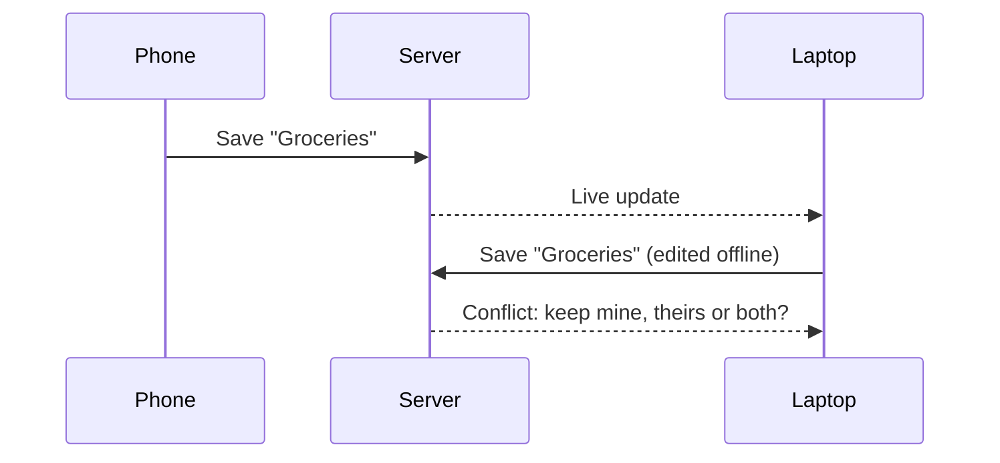

Each of these loads only when a note uses it, so notes without them stay fast. Turn them off in **Settings → Editor → Preview**.

## Code

Name the language after the opening fence and the code is highlighted:

```python
def fizzbuzz(n: int) -> str:
    if n % 15 == 0:
        return "FizzBuzz"
    return "Fizz" if n % 3 == 0 else "Buzz" if n % 5 == 0 else str(n)

print([fizzbuzz(i) for i in range(1, 16)])
```

```js
const words = (text) => text.trim().split(/\s+/).filter(Boolean).length;
console.log(words('Polarboard keeps your notes as plain files'));
```

```bash
podman compose up -d --build
```

## Math

Math goes between dollar signs, inline like $e^{i\pi} + 1 = 0$ or $a^2 + b^2 = c^2$, or on its own lines:

$$
\sum_{k=1}^{n} k = \frac{n(n+1)}{2}
\qquad
\int_0^\infty e^{-x^2}\,dx = \frac{\sqrt{\pi}}{2}
$$

## Diagrams

A code block named `mermaid` becomes a diagram:




