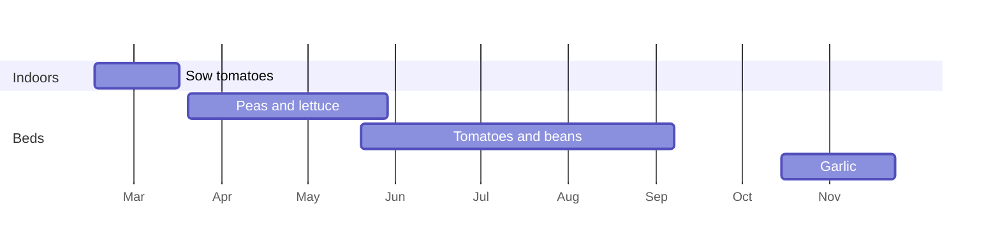

Three raised beds behind the shed, about 1.2 × 2.4 m each. Notes from the season go in the daily notes, like [[2026-11-16]].

## This winter

- [x] Clear the summer beds
- [x] Spread compost over bed 2
- [ ] Order seeds before February
  - [ ] Tomatoes: two cherry, one beefsteak
  - [ ] Basil and parsley
- [ ] Fix the gate latch

## What grows where

| Bed | Spring | Summer | Autumn |
| :--- | :--- | :--- | :--- |
| 1 | Peas | Tomatoes | Garlic |
| 2 | Lettuce | Beans | Spinach |
| 3 | Radishes | Squash | Green manure |

Rotating each bed's crop family every year keeps the soil healthy and pests guessing.

## The year at a glance

> [!tip] Watering
> Roughly 2.5 cm of water a week, more in a heatwave. Water the soil, not the leaves.
